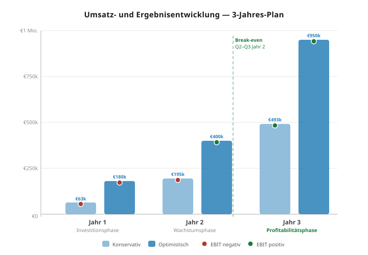

# PrivateMind GmbH — Profit & Loss (3-Jahres-Planung)

*Stand: Juni 2026 — Planwerte, nicht geprüft. Alle Beträge in EUR netto.*
*Grundlage: Businessplan Version 2.0, aktualisiert Juni 2026 (Tier-Struktur + GF-Vergütung)*

---

## 1. Annahmen & Methodik

### Tier-Struktur (aktuell)
| Abo-Tier | Monatspreis | Zielkunde |
|---|---|---|
| Starter | €149 | Kleine Kanzleien, Einzelbetriebe (GX10 Standard/Professional) |
| Professional | €699 | Mittelstand, Teams (GX10 Premium) |
| Enterprise | €1.999 | RZ-Betrieb, hohe Nutzerzahl (ASUS ESC4000A-E12 + 4× NVIDIA L40S) |

### Hardware-Margen
| Produktlinie | VK netto | EK ca. | Marge |
|---|---|---|---|
| Standard | €3.800 | €3.050 | €750 (~20 %) |
| Professional | €4.500 | €3.550 | €950 (~21 %) |
| Premium | €9.500 | €7.100 | €2.400 (~25 %) |
| Enterprise (RZ) | €62.500 | €50.000 | €12.500 (~20 %) |

### GF-Vergütung (Vollkosten GmbH)
| Position | Betrag |
|---|---|
| GF-Gehalt netto | **€5.000 / Monat** |
| GF-Gehalt brutto (ca.) | ~€8.000 / Monat |
| Arbeitgeberanteil Sozialversicherung | ~€1.600 / Monat |
| **Gesamtkosten GmbH (Vollkosten)** | **~€9.600 / Monat = €115.000 / Jahr** |

*Die GF-Vergütung ist expliziter Bestandteil der Finanzierungsplanung und durch KfW ERP StartGeld mitfinanziert.*

### Fixkosten pro Jahr
| Position | Jahr 1 | Jahr 2 konserv. | Jahr 2 optimist. | Jahr 3 konserv. | Jahr 3 optimist. |
|---|---|---|---|---|---|
| GF-Vergütung (Vollkosten) | €115.000 | €115.000 | €115.000 | €115.000 | €115.000 |
| Marketing & Vertrieb | €6.000 | €10.000 | €18.000 | €15.000 | €35.000 |
| Büro / Coworking | €4.800 | €5.400 | €6.000 | €6.000 | €9.000 |
| Versicherungen | €2.400 | €2.400 | €2.400 | €2.400 | €3.000 |
| Software & Tools | €1.800 | €2.400 | €3.600 | €3.600 | €6.000 |
| Steuer- & Rechtsberatung | €4.800 | €5.400 | €6.000 | €6.000 | €7.200 |
| Sonstiges | €3.200 | €3.600 | €4.000 | €4.200 | €6.200 |
| Mitarbeiter (zusätzlich) | — | — | €60.000 (1 FTE) | €60.000 (1 FTE) | €150.000 (2–3 FTE) |
| **Gesamt Fixkosten / Jahr** | **€138.000** | **€144.200** | **€215.000** | **€212.200** | **€331.400** |
| **Gesamt Fixkosten / Monat** | **€11.500** | **€12.017** | **€17.917** | **€17.683** | **€27.617** |

---

## 2. Drei-Jahres-Übersicht



### Konservatives Szenario

| Kennzahl | Jahr 1 | Jahr 2 | Jahr 3 |
|---|---|---|---|
| **Kunden (kumuliert, Ende)** | **10** | **35** | **70** |
| davon Neukunden | 10 | 25 | 35 |
| MRR (Ende Periode) | €2.490 | €10.000 | €25.000 |
| ARR (Ende Periode) | €29.880 | €120.000 | €300.000 |
| — | — | — | — |
| Hardware-Umsatz (VK) | €46.300 | €100.000 | €210.000 |
| Hardware-COGS (EK) | -€35.100 | -€75.000 | -€160.000 |
| Hardware-Marge | €11.200 | €25.000 | €50.000 |
| Setup-Erlöse | €8.000 | €20.000 | €55.000 |
| Abo-Erlöse (Jahressumme) | €9.000 | €75.000 | €230.000 |
| **Gesamtumsatz (VK)** | **€63.300** | **€195.000** | **€493.000** |
| **Bruttogewinn** | **€28.200** | **€120.000** | **€333.000** |
| Bruttomarge | 44,5 % | 61,5 % | 67,5 % |
| — | — | — | — |
| Fixkosten (OPEX) | -€138.000 | -€144.200 | -€212.200 |
| Abschreibungen (AfA) | -€1.700 | -€1.700 | -€1.700 |
| Gründungsaufwand (einmalig) | -€5.000 | — | — |
| **EBIT** | **-€116.500** | **-€25.900** | **+€119.100** |
| Zinsen (KfW-Darlehen, ca.) | -€3.000 | -€2.500 | -€1.500 |
| **EBT** | **-€119.500** | **-€28.400** | **+€117.600** |
| Ertragsteuern (~30 %) | — | — | — ¹ |
| **Jahresergebnis (netto)** | **-€119.500** | **-€28.400** | **+€117.600** |
| Kumuliertes Ergebnis | -€119.500 | -€147.900 | -€30.300 |

*¹ Verlustvortrag (§ 10d EStG) kumuliert J1+J2: €147.900. Da J3-EBT (€117.600) < Verlustvortrag, sind keine Ertragsteuern fällig — Jahresergebnis = EBT. Verbleibender Verlustvortrag für J4: €30.300.*

---

### Optimistisches Szenario

| Kennzahl | Jahr 1 | Jahr 2 | Jahr 3 |
|---|---|---|---|
| **Kunden (kumuliert, Ende)** | **25** | **60** | **120** |
| davon Neukunden | 25 | 35 | 60 |
| MRR (Ende Periode) | €6.225 | €20.000 | €50.000 |
| ARR (Ende Periode) | €74.700 | €240.000 | €600.000 |
| — | — | — | — |
| Hardware-Umsatz (VK) | €124.100 | €200.000 | €400.000 |
| Hardware-COGS (EK) | -€101.000 | -€150.000 | -€300.000 |
| Hardware-Marge | €23.100 | €50.000 | €100.000 |
| Setup-Erlöse | €25.000 | €50.000 | €100.000 |
| Abo-Erlöse (Jahressumme) | €31.000 | €150.000 | €450.000 |
| **Gesamtumsatz (VK)** | **€180.100** | **€400.000** | **€950.000** |
| **Bruttogewinn** | **€79.100** | **€250.000** | **€650.000** |
| Bruttomarge | 43,9 % | 62,5 % | 68,4 % |
| — | — | — | — |
| Fixkosten (OPEX) | -€138.000 | -€215.000 | -€331.400 |
| Abschreibungen (AfA) | -€1.700 | -€1.700 | -€1.700 |
| Gründungsaufwand (einmalig) | -€5.000 | — | — |
| **EBIT** | **-€65.600** | **+€33.300** | **+€316.900** |
| Zinsen (KfW-Darlehen, ca.) | -€3.000 | -€1.500 | — |
| **EBT** | **-€68.600** | **+€31.800** | **+€316.900** |
| Ertragsteuern (~30 %) | — | — ¹ | -€84.030 ¹ |
| **Jahresergebnis (netto)** | **-€68.600** | **+€31.800** | **+€232.870** |
| Kumuliertes Ergebnis | -€68.600 | -€36.800 | +€196.070 |

*¹ Verlustvortrag (§ 10d EStG) aus J1: €68.600. J2-EBT (+€31.800) durch VV gedeckt — keine Steuern in J2. Verbleibender VV nach J2: €36.800. J3: Steuerpflichtiges Einkommen = €316.900 − €36.800 = €280.100; Ertragsteuern ~30 % = €84.030.*

---

## 3. Detaillierte Jahres-P&L

### Jahr 1 — Konservativ (10 Kunden)

```
UMSATZ
  Hardware-Umsatz (VK netto)        €46.300
  Setup-Erlöse                       €8.000
  Abo-Erlöse (kumuliert Monate 3–12) €9.000
  ──────────────────────────────────────────
  Gesamtumsatz                      €63.300

COGS
  Hardware-Einkaufskosten           -€35.100
  ──────────────────────────────────────────
  Bruttogewinn                      €28.200   (44,5 %)

OPERATING EXPENSES
  GF-Vergütung Vollkosten          -€115.000   ← €5.000 netto/Monat
  Marketing & Vertrieb               -€6.000
  Büro / Coworking                   -€4.800
  Versicherungen                     -€2.400
  Software & Tools                   -€1.800
  Steuer- & Rechtsberatung           -€4.800
  Sonstiges                          -€3.200
  ──────────────────────────────────────────
  Fixkosten gesamt                 -€138.000

  Abschreibungen (AfA)               -€1.700
  Gründungsaufwand (einmalig)        -€5.000
  ──────────────────────────────────────────
  EBIT                             -€116.500

  Zinsen (KfW-Darlehen ~€100k)       -€3.000
  ──────────────────────────────────────────
  EBT                              -€119.500
  Ertragsteuern                         €0   (Verlustvortrag)
  ──────────────────────────────────────────
  JAHRESERGEBNIS                   -€119.500
```

**Finanzierungsplan Jahr 1:**
| Quelle | Betrag | Empfänger |
|---|---|---|
| Stammkapital GmbH | €25.000 | GmbH |
| KfW ERP-Gründerkredit StartGeld | €100.000 | GmbH |
| SAB Mikrodarlehen | €20.000 | GmbH |
| **Gesamt GmbH-Finanzierung** | **€145.000** | |
| Kapitalbedarf inkl. Puffer | ~€130.000–€140.000 | |
| **Puffer** | **~€5.000–€15.000** | |
| — | — | — |
| Gründungszuschuss AfA (persönlich) ¹ | ~€16.500 | Gründer |
| InnoStartBonus Sachsen (persönlich) ¹ | ~€12.600 | Gründer |

*¹ Fließen dem Gründer persönlich zu, unabhängig von der GmbH-Bilanz. Doppelabsicherung: GmbH-Gehalt + persönliche Fördermittel.*

---

### Jahr 1 — Optimistisch (25 Kunden)

```
UMSATZ
  Hardware-Umsatz (VK netto)       €124.100
  Setup-Erlöse                      €25.000
  Abo-Erlöse (kumuliert)            €31.000
  ──────────────────────────────────────────
  Gesamtumsatz                     €180.100

COGS
  Hardware-Einkaufskosten          -€101.000
  ──────────────────────────────────────────
  Bruttogewinn                      €79.100   (43,9 %)

OPERATING EXPENSES
  Fixkosten gesamt                 -€138.000
  Abschreibungen (AfA)               -€1.700
  Gründungsaufwand (einmalig)        -€5.000
  ──────────────────────────────────────────
  EBIT                              -€65.600

  Zinsen (KfW)                       -€3.000
  ──────────────────────────────────────────
  EBT                               -€68.600
  Ertragsteuern                         €0   (Verlustvortrag)
  ──────────────────────────────────────────
  JAHRESERGEBNIS                    -€68.600
```

---

### Jahr 2 — Konservativ (35 Kunden kumuliert)

```
UMSATZ
  Hardware-Umsatz (VK netto)       €100.000
  Setup-Erlöse                      €20.000
  Abo-Erlöse (Ø MRR €6.250 × 12)   €75.000
  ──────────────────────────────────────────
  Gesamtumsatz                     €195.000

COGS
  Hardware-Einkaufskosten           -€75.000
  ──────────────────────────────────────────
  Bruttogewinn                     €120.000   (61,5 %)

OPERATING EXPENSES
  Fixkosten gesamt (kein neuer FTE) -€144.200
  Abschreibungen (AfA)               -€1.700
  ──────────────────────────────────────────
  EBIT                              -€25.900

  Zinsen (KfW, Tilgung läuft)        -€2.500
  ──────────────────────────────────────────
  EBT                               -€28.400
  Ertragsteuern                         €0   (Verlustvortrag)
  ──────────────────────────────────────────
  JAHRESERGEBNIS                    -€28.400
```

> **Hinweis konservativ J2:** Noch leicht negativ — Break-even operativ wird ca. Q3 Jahr 2 erreicht
> (MRR ~€11.500 ≙ ~17 Professional-Kunden oder ~25 Mischkunden). Der Fehlbetrag ist planbar
> und durch den KfW-Kreditrahmen gedeckt.

---

### Jahr 2 — Optimistisch (60 Kunden kumuliert)

```
UMSATZ
  Hardware-Umsatz (VK netto)       €200.000
  Setup-Erlöse                      €50.000
  Abo-Erlöse (Ø MRR €12.500 × 12) €150.000
  ──────────────────────────────────────────
  Gesamtumsatz                     €400.000

COGS
  Hardware-Einkaufskosten          -€150.000
  ──────────────────────────────────────────
  Bruttogewinn                     €250.000   (62,5 %)

OPERATING EXPENSES
  GF-Vergütung Vollkosten          -€115.000
  1 zusätzlicher FTE               -€60.000
  Weitere Fixkosten                 -€40.000
  ──────────────────────────────────────────
  Fixkosten gesamt                 -€215.000
  Abschreibungen (AfA)               -€1.700
  ──────────────────────────────────────────
  EBIT                             +€33.300

  Zinsen                             -€1.500
  ──────────────────────────────────────────
  EBT                              +€31.800
  Ertragsteuern                         €0   (Verlustvortrag aus J1 genutzt)
  ──────────────────────────────────────────
  JAHRESERGEBNIS                        €0   (Gewinn = Verlustverrechnung)
```

---

### Jahr 3 — Konservativ (70 Kunden kumuliert)

```
UMSATZ
  Hardware-Umsatz (VK netto)       €210.000
  Setup-Erlöse                      €55.000
  Abo-Erlöse (Ø MRR €19.000 × 12) €228.000
  ──────────────────────────────────────────
  Gesamtumsatz                     €493.000

COGS
  Hardware-Einkaufskosten          -€160.000
  ──────────────────────────────────────────
  Bruttogewinn                     €333.000   (67,5 %)

OPERATING EXPENSES
  GF-Vergütung Vollkosten          -€115.000
  1 zusätzlicher FTE               -€60.000
  Weitere Fixkosten                 -€37.200
  ──────────────────────────────────────────
  Fixkosten gesamt                 -€212.200
  Abschreibungen (AfA)               -€1.700
  ──────────────────────────────────────────
  EBIT                            +€119.100

  Zinsen (Restschuld KfW)            -€1.500
  ──────────────────────────────────────────
  EBT                             +€117.600
  Ertragsteuern (nach Verlustv.)         €0   (Verlustvortrag ~€147.900 > Gewinn)
  ──────────────────────────────────────────
  JAHRESERGEBNIS                  +€117.600
```

---

### Jahr 3 — Optimistisch (120 Kunden kumuliert)

```
UMSATZ
  Hardware-Umsatz (VK netto)       €400.000
  Setup-Erlöse                     €100.000
  Abo-Erlöse (Ø MRR €37.500 × 12) €450.000
  ──────────────────────────────────────────
  Gesamtumsatz                     €950.000

COGS
  Hardware-Einkaufskosten          -€300.000
  ──────────────────────────────────────────
  Bruttogewinn                     €650.000   (68,4 %)

OPERATING EXPENSES
  GF-Vergütung Vollkosten          -€115.000
  2–3 FTE                         -€150.000
  Weitere Fixkosten                 -€66.400
  ──────────────────────────────────────────
  Fixkosten gesamt                 -€331.400
  Abschreibungen (AfA)               -€1.700
  ──────────────────────────────────────────
  EBIT                            +€316.900

  Zinsen                                €0
  ──────────────────────────────────────────
  EBT                             +€316.900
  Ertragsteuern (~30 %, nach Verl.)  -€95.070
  ──────────────────────────────────────────
  JAHRESERGEBNIS                  +€221.830
```

---

## 4. Kennzahlen-Zusammenfassung

| Kennzahl | J1 Konserv. | J1 Optimist. | J2 Konserv. | J2 Optimist. | J3 Konserv. | J3 Optimist. |
|---|---|---|---|---|---|---|
| Kunden (Ende) | 10 | 25 | 35 | 60 | 70 | 120 |
| MRR (Ende) | €2.490 | €6.225 | €10.000 | €20.000 | €25.000 | €50.000 |
| Gesamtumsatz | €63.300 | €180.100 | €195.000 | €400.000 | €493.000 | €950.000 |
| Bruttomarge | 44,5 % | 43,9 % | 61,5 % | 62,5 % | 67,5 % | 68,4 % |
| EBIT | **-€116.500** | **-€65.600** | **-€25.900** | **+€33.300** | **+€119.100** | **+€316.900** |
| EBIT-Marge | n/a | n/a | n/a | 8,3 % | 24,2 % | 33,4 % |
| Jahresergebnis | **-€119.500** | **-€68.600** | **-€28.400** | **+€31.800** | **+€117.600** | **+€232.870** |
| Kum. Ergebnis | -€119.500 | -€68.600 | -€147.900 | -€36.800 | -€30.300 | +€196.070 |

---

## 5. Break-even & kritische Schwellen

| Schwelle | Bedingung | Szenario |
|---|---|---|
| **Operativer Break-even (monatlich)** | MRR ≥ €11.500 | ~17 Professional-Kunden (€699) **oder** ~78 Starter-Kunden (€149) **oder** Mix aus ~20–25 aktiven Kunden |
| **Break-even operativ erreicht** | MRR ≥ Fixkosten | Konservativ: ~Q3 Jahr 2 / Optimistisch: ~Q2 Jahr 2 |
| **Break-even kumuliert** | Verluste aus J1/J2 ausgeglichen | Konservativ: ~Jahr 4 / Optimistisch: ~Jahr 3 |
| **GF-Gehalt kostendeckend** | Abo-MRR ≥ €9.600 | ~14 Professional-Kunden oder ~65 Starter-Kunden |
| **Erste Enterprise-RZ-Kunden (Upside)** | 1 Kunde = €1.999/Mo. + €62.500 Hardware | Verbessert Break-even erheblich — 1 Enterprise = ~13 Professional |

---

## 6. Finanzierungsübersicht

### GmbH-Finanzierung (operativ)
| Quelle | Betrag | Wann |
|---|---|---|
| Stammkapital (Eigenkapital) | €25.000 | Tag 1 |
| KfW ERP-Gründerkredit StartGeld | bis €125.000 | ≤ 3 Monate nach Gründung |
| SAB Mikrodarlehen Sachsen | bis €20.000 | Ab Monat 3 |
| **Gesamt verfügbar (GmbH)** | **bis €165.000** | |
| **Bedarf Jahr 1 (konservativ)** | **~€130.000–€145.000** | |
| **Puffer** | **~€20.000–€35.000** | |

### Persönliche Fördermittel des Gründers (zusätzlich, unabhängig von GmbH)
| Quelle | Betrag | Hinweis |
|---|---|---|
| Gründungszuschuss AfA (15 Mo.) | ~€16.500 | Ergänzung zur GmbH-Vergütung |
| InnoStartBonus Sachsen | ~€12.600 | Ergänzung zur GmbH-Vergütung |
| **Gesamt persönlich** | **~€29.100** | Fließt dem Gründer direkt zu |

> **Gesamtbild:** GmbH finanziert das GF-Gehalt (€115.000/Jahr) vollständig aus Stammkapital + KfW-Darlehen. Die persönlichen Fördermittel (Gründungszuschuss, InnoStartBonus) sind eine zusätzliche Einkommensabsicherung und stärken die Liquidität des Gründers in der Anlaufphase.

---

## 7. Hinweise & Einschränkungen

- **GF-Gehalt:** €5.000 netto / Monat = ca. €115.000/Jahr Vollkosten GmbH. Enthält Arbeitgeberanteil Sozialversicherung (~€1.600/Mo.) und Bruttolohn (~€8.000–8.400/Mo.). Exakter Betrag abhängig von Steuerklasse und SV-Beitragsatz — mit Steuerberater finalisieren.
- **Steuerrate:** ~30 % effektiv (GmbH: KSt 15 % + SolZ 0,825 % + GewSt Dresden ~15 %). Verlustvortrag aus J1/J2 wird nach § 10d EStG vorgetragen und verrechnet.
- **Zinsen KfW:** Annahme ~3 % p.a. auf €100.000 Darlehen = ~€3.000/Jahr; sinkt mit Tilgung.
- **Enterprise-RZ-Tier:** Noch nicht in den Planwerten eingerechnet — jeder Enterprise-Abschluss (€1.999/Mo. Abo + €62.500 Hardware einmalig) ist erheblicher Upside.
- **Alle Beträge netto** (ohne Umsatzsteuer). B2B: Vorsteuerabzug gilt.
- **Validierungspflicht:** Zahlen müssen durch Steuerberater auf Basis tatsächlicher Buchführung validiert werden. Insbesondere: GF-Gehaltsstruktur, optimale Versorgungsformen (bAV, Dienstwagen, etc.) und Verlustverrechnungsstrategie.

---

*Dokument: PrivateMind_PnL_3Jahre.md | Stand: Juni 2026 | Autor: Raffael Reichelt*
